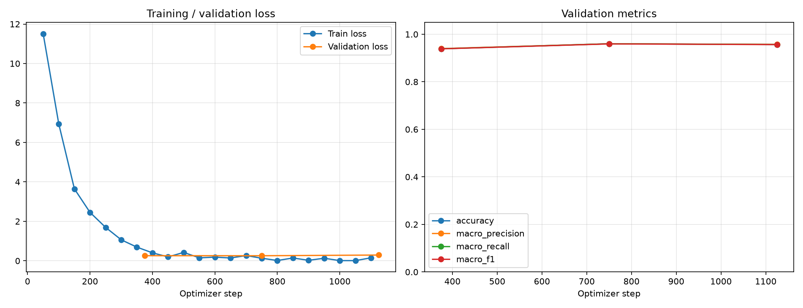
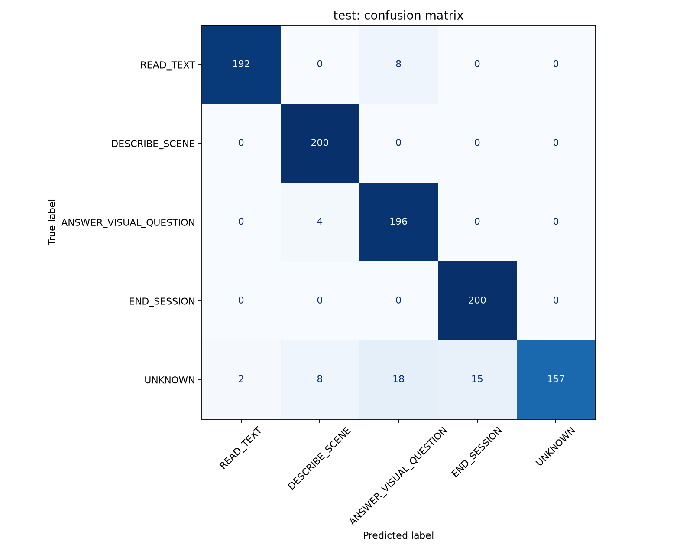

<div align="center">

# Vietnamese Intent Classification

**Phân loại ý định tiếng Việt với PhoBERT-base-v2**

8.000 câu · 5 nhãn · Test accuracy **94,50%** · Test macro-F1 **94,36%**

[Kết quả](#kết-quả) · [Dữ liệu](#dữ-liệu) · [Cài đặt](#cài-đặt) · [Dự đoán](#chạy-dự-đoán) · [Huấn luyện](#huấn-luyện)

</div>

---

## Giới thiệu

Fine-tune **PhoBERT-base-v2** để phân loại yêu cầu tiếng Việt thành 5 ý định,
phục vụ hệ thống hỗ trợ đọc chữ và tìm hiểu môi trường qua hình ảnh.
Đầu vào là văn bản; đầu ra là một nhãn ý định. Model chỉ phân loại yêu cầu;
đọc ảnh, mô tả ảnh và trả lời câu hỏi về ảnh là nhiệm vụ của thành phần khác.

| ID | Nhãn | Ý nghĩa | Ví dụ |
|---:|---|---|---|
| 1 | `READ_TEXT` | Yêu cầu đọc chữ | Đọc dòng chữ trên cửa. |
| 2 | `DESCRIBE_SCENE` | Yêu cầu mô tả cảnh | Mô tả toàn cảnh nhà bếp. |
| 3 | `ANSWER_VISUAL_QUESTION` | Hỏi chi tiết từ hình ảnh | Trong hình có bao nhiêu người? |
| 4 | `END_SESSION` | Kết thúc phiên hỗ trợ | Đóng phiên này giúp tôi. |
| 5 | `UNKNOWN` | Ngoài các ý định được hỗ trợ | Bày tôi cách nấu cháo. |

```text
Văn bản → Chuẩn hóa → VnCoreNLP → PhoBERT tokenizer → PhoBERT → Nhãn ý định
```

## Kết quả

Model được chọn theo **validation macro-F1**, sau đó đánh giá trên test.
Precision, recall và F1 là trung bình macro trên 5 nhãn.

| Tập đánh giá | Số câu | Accuracy | Precision | Recall | F1 |
|---|---:|---:|---:|---:|---:|
| Train | 6.000 | 99,90% | 99,90% | 99,90% | 99,90% |
| Validation | 1.000 | 96,00% | 95,99% | 96,00% | 95,94% |
| **Test** | **1.000** | **94,50%** | **94,92%** | **94,50%** | **94,36%** |
| Kiểm tra bổ sung¹ | 25 | 88,00% | 92,50% | 88,00% | 88,72% |

¹ Bộ 25 câu tự viết, gán nhãn kỳ vọng thủ công, không trùng nguyên văn với
train. Đây là kiểm tra nhỏ để tìm lỗi, không thay thế tập test độc lập.

### Theo từng nhãn trên tập test

| Nhãn | Precision | Recall | F1 | Số câu |
|---|---:|---:|---:|---:|
| `READ_TEXT` | 98,97% | 96,00% | 97,46% | 200 |
| `DESCRIBE_SCENE` | 94,34% | 100,00% | 97,09% | 200 |
| `ANSWER_VISUAL_QUESTION` | 88,29% | 98,00% | 92,89% | 200 |
| `END_SESSION` | 93,02% | 100,00% | 96,39% | 200 |
| `UNKNOWN` | 100,00% | 78,50% | 87,96% | 200 |

### Biểu đồ

**Loss và các chỉ số validation trong quá trình huấn luyện**



**Ma trận nhầm lẫn trên tập test**



### Kiểm thử thực tế

**Các nhãn nghiệp vụ hoạt động khá tốt với yêu cầu cơ bản.** Model phân biệt
được đọc chữ với hỏi thuộc tính của chữ, mô tả toàn cảnh với hỏi chi tiết,
và xử lý được một số cách diễn đạt gián tiếp.

| Đầu vào | Model dự đoán | Kết quả |
|---|---|---|
| Đọc các chữ trên chai nước. | `READ_TEXT` | Đúng |
| Các chữ trên chai nước có màu gì? | `ANSWER_VISUAL_QUESTION` | Đúng |
| Mô tả toàn cảnh nhà bếp. | `DESCRIBE_SCENE` | Đúng |
| Khoan kết thúc phiên, mô tả căn phòng trước mặt tôi đã. | `DESCRIBE_SCENE` | Đúng |
| Tôi không muốn nghe mô tả nữa, đóng phiên hỗ trợ này giúp tôi. | `END_SESSION` | Đúng |

**Nhận diện `UNKNOWN` là điểm yếu cần ưu tiên cải thiện.** Các yêu cầu ngoài
phạm vi nhưng chứa từ khóa gần với nhãn nghiệp vụ có thể bị gán sang nhãn
khác. Trên test, model bỏ sót **43/200 câu `UNKNOWN`**. Một số dự đoán sai
vẫn có điểm softmax cao.

| Đầu vào khó | Nhãn kỳ vọng | Model dự đoán |
|---|---|---|
| Dịch câu “kết thúc phiên hỗ trợ này” sang tiếng Anh. | `UNKNOWN` | `READ_TEXT` |
| từ kết thúc trong tiếng Anh viết thế nào | `UNKNOWN` | `READ_TEXT` |
| không cần đọc chữ, chỉ mô tả khung cảnh thôi | `DESCRIBE_SCENE` | `READ_TEXT` |
| doc nguyen van nhung chu tren to giay nay giup toi | `READ_TEXT` | `ANSWER_VISUAL_QUESTION` |

Các ví dụ tương tác là quan sát bổ sung, không được cộng vào bảng chỉ số.
Chênh lệch accuracy train–test là **5,4 điểm phần trăm**. Validation macro-F1
giảm nhẹ từ epoch 2 sang epoch 3 trong khi train loss tiếp tục giảm, cho thấy
dấu hiệu overfit nhẹ. Chưa đủ bằng chứng khẳng định model không học vẹt.

## Dữ liệu

Dataset gồm **8.000 câu**, mỗi câu có một ý định. Cả ba tập đều cân bằng:
mỗi nhãn chiếm **20%**. CSV và JSONL là hai định dạng của cùng dữ liệu,
không phải hai bộ mẫu độc lập.

| Tập | File CSV | Số câu | Tỷ lệ | Số câu mỗi nhãn |
|---|---|---:|---:|---:|
| Train | `train.csv` | 6.000 | 75% | 1.200 |
| Validation | `val.csv` | 1.000 | 12,5% | 200 |
| Test | `test.csv` | 1.000 | 12,5% | 200 |
| **Tổng** | | **8.000** | **100%** | **1.600** |

<details>
<summary><strong>Phân bố từng nhãn</strong></summary>

| ID | Nhãn | Train | Validation | Test | Tổng |
|---:|---|---:|---:|---:|---:|
| 1 | `READ_TEXT` | 1.200 | 200 | 200 | 1.600 |
| 2 | `DESCRIBE_SCENE` | 1.200 | 200 | 200 | 1.600 |
| 3 | `ANSWER_VISUAL_QUESTION` | 1.200 | 200 | 200 | 1.600 |
| 4 | `END_SESSION` | 1.200 | 200 | 200 | 1.600 |
| 5 | `UNKNOWN` | 1.200 | 200 | 200 | 1.600 |

</details>

### Định dạng

| Cột CSV gốc | Kiểu | Nội dung |
|---|---|---|
| `text` | Chuỗi | Văn bản đầu vào |
| `label` | Chuỗi | Tên nhãn ý định |
| `label_id` | Số nguyên | ID nhãn gốc 1–5 |

Tiền xử lý giữ các cột gốc, bổ sung `text_clean` (chuẩn hóa Unicode NFC và
khoảng trắng), `text_segmented` (đã tách từ) và `labels` (ID gốc 1–5).
Chỉ khi tính loss, nhãn mới được đổi sang chỉ số nội bộ **0–4**.
Dự đoán trả về tên nhãn và ID gốc **1–5**.

JSONL có thêm `slots`, `tokens`, `tags`; các loại slot gồm `OBJECT`,
`LOCATION`, `ATTRIBUTE`, `PLACE`. Tác vụ hiện tại chỉ dùng CSV và tách từ
lại từ `text`, chưa huấn luyện trích xuất slot. Đã kiểm tra `text`, `label`,
`label_id` khớp từng dòng giữa CSV và JSONL của mỗi tập.

<details>
<summary><strong>Thống kê độ dài câu và token</strong></summary>

“Đơn vị cách trắng” được đếm bằng `text.split()` trước tách từ, không phải
số từ tiếng Việt đã phân đoạn. Ký tự bao gồm khoảng trắng và dấu câu.

| Tập | Đơn vị cách trắng TB | Min–max | Ký tự TB | Ký tự min–max |
|---|---:|---|---:|---|
| Train | 9,50 | 1–27 | 38,94 | 1–113 |
| Validation | 9,79 | 1–22 | 40,53 | 3–96 |
| Test | 9,38 | 1–24 | 38,33 | 1–98 |

Trung vị là 9 đơn vị cách trắng ở cả ba tập; ít nhất 95% câu trong mỗi tập
không quá 16 đơn vị cách trắng.

Token PhoBERT được đo sau VnCoreNLP, **bao gồm token đặc biệt**:

| Tập | Token TB | Min | P95 | Max | Số câu vượt 128 token |
|---|---:|---:|---:|---:|---:|
| Train | 10,70 | 3 | 17 | 26 | 0 |
| Validation | 10,95 | 3 | 17 | 25 | 0 |
| Test | 10,61 | 3 | 17 | 25 | 0 |

Không câu nào trong dataset hiện tại bị cắt bởi `max_length=128`.

</details>

### Kiểm tra chất lượng

- Không có giá trị thiếu ở ba cột CSV gốc.
- Không phát hiện câu trùng trong hoặc giữa các tập sau chuẩn hóa Unicode,
  khoảng trắng và chữ hoa/thường.
- Có **13/1.000 câu test** giống câu train gần nhất từ 0,9 trở lên theo cosine
  similarity của TF-IDF ký tự 3–5 gram. Đây là độ giống từ vựng, chưa phải
  bằng chứng trùng ngữ nghĩa hay rò rỉ dữ liệu.
- Xáo trộn riêng từng tập với `seed=42`, giữ nguyên phân chia tập ban đầu.
- Nguồn thu thập, cách tạo câu, quy trình gán nhãn và tiêu chí chia tập chưa
  được xác minh. Cân bằng nhãn chưa bảo đảm đa dạng cách diễn đạt.

## Cài đặt

**Yêu cầu:** Python 3.11, Java 8+ trong `PATH`, Git và Git LFS.
Môi trường đã kiểm tra: Windows và PyTorch CPU. Các lệnh dưới dùng PowerShell.

### 1. Tải repository

```powershell
git lfs install
git clone https://github.com/NguyenThHien/NLU.git
cd NLU
git lfs pull
```

Repository lưu cả model, checkpoint và môi trường Windows nên dung lượng lớn.
File lớn được quản lý qua Git LFS. `.venv` được lưu để tham khảo; trên máy
mới nên tạo lại môi trường thay vì dùng trực tiếp môi trường từ máy khác.

### 2. Tạo môi trường Python

```powershell
python -m venv .venv
.\.venv\Scripts\Activate.ps1
python -m pip install torch --index-url https://download.pytorch.org/whl/cpu
python -m pip install -r requirements.txt
java -version
```

Nếu PowerShell chặn kích hoạt, cho phép trong phiên terminal hiện tại:

```powershell
Set-ExecutionPolicy -Scope Process -ExecutionPolicy Bypass
.\.venv\Scripts\Activate.ps1
```

### 3. Chuẩn bị tài nguyên khi chưa có

```powershell
python .\model\download_model.py
python .\model\download_vncorenlp.py
```

VnCoreNLP chỉ tải thành phần tách từ. Bỏ qua bước này nếu đã tải đủ tài nguyên
từ repository và Git LFS.

## Chạy dự đoán

Sử dụng model đã fine-tune tại `outputs/phobert_intent/final_model`:

```powershell
python .\finetune\predict.py
```

Ví dụ nhập tại terminal:

```text
Van ban: Đọc các chữ trên chai nước.
Nhan du doan: READ_TEXT
ID nhan: 1
```

Nhập tiếp câu khác để thử hoặc gõ `/exit` để thoát. Chương trình hiển thị
thêm văn bản đã tách từ và điểm softmax của cả 5 nhãn.

## Huấn luyện

### Tiền xử lý

```powershell
python .\finetune\preprocess.py
```

Chuẩn hóa Unicode và khoảng trắng → tách từ → tạo `labels` → xáo trộn
→ lưu vào `dataset/processed/`. Không ghi đè CSV gốc.

### Chạy thử và fine-tune

```powershell
# Kiểm tra luồng chạy bằng 2 optimizer steps
python .\finetune\train.py --smoke

# Huấn luyện đầy đủ
python .\finetune\train.py
```

| Tham số | Giá trị |
|---|---|
| Model nền | `vinai/phobert-base-v2` |
| Epochs | 3 |
| Learning rate | `2e-5` |
| Train / eval batch size | 2 / 4 |
| Gradient accumulation | 8 bước |
| Weight decay | 0,01 |
| Max sequence length | 128 token |
| Seed | 42 |
| Thiết bị | CPU |
| Chọn model tốt nhất | Validation macro-F1 |

Validation và checkpoint được ghi sau mỗi epoch. Trong lần train hiện tại,
model ở epoch 2 được chọn. Test được đánh giá sau khi chọn model.

### File kết quả

| Đường dẫn trong `outputs/phobert_intent/` | Nội dung |
|---|---|
| `final_model/` | Model tốt nhất và tokenizer |
| `training_curves.png` | Loss và validation metrics |
| `test_confusion_matrix.png` | Ma trận nhầm lẫn |
| `test_metrics.png` | Biểu đồ accuracy, precision, recall, F1 |
| `test_report.csv` | Precision, recall, F1 theo nhãn |
| `test_predictions.csv` | Nhãn thật và nhãn dự đoán |
| `test_results.json` | Chỉ số tổng hợp |

Các báo cáo tương tự có tiền tố `validation_`. Chạy thử lưu riêng ở
`outputs/smoke_test/`; không dùng model chạy thử để báo cáo chất lượng.

## Kiểm tra tổng quát hóa

```powershell
python .\finetune\audit_model.py
```

Script không train lại: đánh giá train/validation/test, kiểm tra câu trùng,
đo độ giống từ vựng và dự đoán 25 câu mới gán nhãn thủ công.

| File trong `outputs/model_audit/` | Nội dung |
|---|---|
| `summary.json` | Chỉ số và thống kê trùng lặp |
| `manual_predictions.csv` | Dự đoán của 25 câu mới |
| `nearest_train.csv` | Câu train gần nhất với từng câu test |

## Cấu trúc dự án

```text
NLU/
├── dataset/                 # CSV, JSONL gốc và processed/
├── finetune/
│   ├── common.py            # Cấu hình, nhãn và xử lý văn bản dùng chung
│   ├── preprocess.py        # Tiền xử lý
│   ├── train.py             # Fine-tune, đánh giá, biểu đồ
│   ├── predict.py           # Dự đoán tương tác
│   ├── audit_model.py       # Kiểm tra tổng quát hóa
│   └── test_tokenizer.py    # Kiểm tra tokenizer
├── model/
│   ├── download_model.py
│   ├── download_vncorenlp.py
│   ├── phobert-base-v2/
│   └── vncorenlp/
├── outputs/                 # Checkpoint, model, báo cáo, biểu đồ
├── .gitattributes           # Quy tắc Git LFS
├── .gitignore
├── requirements.txt
└── README.md
```

## Giới hạn và hướng phát triển

- Mỗi đầu vào chỉ có một nhãn; chưa có quy tắc cho yêu cầu chứa nhiều ý định.
- Đầu vào trên 128 token bị cắt; dữ liệu hiện tại chủ yếu là câu ngắn.
- Ưu tiên bổ sung `UNKNOWN`, câu phủ định, từ khóa gây nhiễu và tiếng Việt
  không dấu.
- Softmax chưa được hiệu chỉnh, không phải mức bảo đảm dự đoán đúng.
- Cần tập đánh giá độc lập theo nguồn hoặc mẫu câu; đánh giá lại cùng test
  không tạo ra một tập kiểm tra mới.

## Tài nguyên tham khảo

- [PhoBERT-base-v2 — VinAI](https://huggingface.co/vinai/phobert-base-v2)
- [VnCoreNLP](https://github.com/vncorenlp/VnCoreNLP)
- [Python wrapper cho VnCoreNLP](https://github.com/dnanhkhoa/python-vncorenlp)

Model và thư viện bên thứ ba tuân theo giấy phép của từng nguồn. Repository
lưu toàn bộ tài nguyên và môi trường theo yêu cầu của chủ dự án; `.env`
vẫn được loại trừ để tránh công khai cấu hình riêng tư.
